  

  
  
  
  

  
  
  
  
  
  

## About

I have 4+ years of experience building scalable web apps and APIs with Node.js, NestJS, TypeScript, React/Next.js and Vue/Nuxt, backed by MongoDB. I’ve built multi-tenant SaaS apps and worked on ERP, accounting and fintech systems. I also build with AI tools, and I want to build AI-powered products like chatbots and virtual assistants.

<table width="100%">
  <tr>
    <td align="center" width="25%"><h3>4+</h3>years building production web apps</td>
    <td align="center" width="25%"><h3>100+</h3>repositories, public and private</td>
    <td align="center" width="25%"><h3>8</h3>featured projects below, most with live demos</td>
    <td align="center" width="25%"><h3>SaaS · ERP · Fintech</h3>business systems experience</td>
  </tr>
</table>

## Tech stack

 

 

## Projects

Click a project to open its details and links.

<b>Maha Plan — مخطط المها العقاري</b> &nbsp;·&nbsp; <i>Real estate sales and price quotes</i>

> Arabic real estate sales and price-quotation portal for the Al-Maha plan (No. 4047), fully developed and designed with AI-assisted tools.

<b>Mzadaty</b> &nbsp;·&nbsp; <i>Auction management dashboard</i>

> A dashboard for managing auctions between providers and clients. It shows auction progress in real time and has a built-in live chat.

 

<b>OPC</b> &nbsp;·&nbsp; <i>E-commerce marketplace</i>

> A Nuxt.js marketplace connecting sellers and customers, with real-time updates, buyer–seller chat, advanced filters and multiple payment options.

 

<b>نظام الحضور والانصراف لمنطقة حفر الباطن</b> &nbsp;·&nbsp; <i>Attendance system, Hafr Al-Batin</i>

> An attendance system built as a scalable enterprise dashboard. It has role-based access (Super Admin, Admin, HR, Manager, Employee), a sidebar that changes by role, real-time search, and full RTL/LTR support.

 

<b>Thunder</b> &nbsp;·&nbsp; <i>Restaurant dashboard</i>

> A dashboard that connects restaurants with customers: order management, real-time communication, financial tracking, ratings, invoice exports and a 4-minute order acceptance window.

 

<b>Co Research</b> &nbsp;·&nbsp; <i>Research collaboration platform</i>

> A platform where researchers and organizations find opportunities, join scientific projects and manage collaboration, with subscription-based organization management.

 

<b>Athena</b> &nbsp;·&nbsp; <i>Educational platform in React.js</i>

> A learning platform with real-time features, online exams, assignments, progress tracking, and separate dashboards for students, parents and teachers.

<b>CMS Platform</b> &nbsp;·&nbsp; <i>Full-stack content management</i>

> A CMS with a drag-and-drop page builder, reusable components and multi-language rendering for multiple projects, on a NestJS and MongoDB API.

 

## Experience

<b>FullStack Developer (Nest.js)</b> &nbsp;·&nbsp; Mazaya Integrated Solutions Co. &nbsp;·&nbsp; <i>Aug 2025 – Sep 2026</i>

- Built scalable full-stack apps with Nuxt.js/Vue.js, NestJS and TypeScript, applying OOP and SOLID principles.
- Helped the team deliver critical projects ahead of the deadline.
- Solved complex problems that were blocking tasks, and supported teammates with the problems they faced.
- Made communication easier between Product, Back-end and QA teams.
- Ran code reviews, mentored teammates and wrote technical documentation.

<b>Mid-Level Frontend Developer</b> &nbsp;·&nbsp; AAIT Company &nbsp;·&nbsp; <i>Nov 2023 – Aug 2025</i>

- Built high-performance web apps with Vue.js and Nuxt.js.
- Made reusable PrimeVue components, integrated REST APIs and managed state with Vuex and Pinia.
- Worked with UX/UI designers to turn wireframes into interactive pages.

<b>Junior Frontend Developer</b> &nbsp;·&nbsp; Athena &nbsp;·&nbsp; <i>Jun 2022 – May 2023</i>

- Led development of the student module for a large React.js educational platform.
- Added Arabic and English support and light and dark themes.
- Built registration, lesson scheduling, online exams and progress tracking, fully responsive down to 320px.

<b>Junior Frontend Developer</b> &nbsp;·&nbsp; ElRyad &nbsp;·&nbsp; <i>Mar 2021 – Feb 2022</i>

- Built responsive interfaces with HTML, CSS, JavaScript and jQuery, and worked with backend engineers on new features.

## Education & Certificates

## Skills

<table width="100%">
  <tr><td width="200"><b>Languages</b></td><td>JavaScript (ES6+), TypeScript, HTML5, CSS3 / SASS</td></tr>
  <tr><td width="200"><b>Back-end and APIs</b></td><td>Node.js, NestJS, RESTful APIs and web services, API integration, Firebase</td></tr>
  <tr><td width="200"><b>Databases</b></td><td>MongoDB, MySQL, SQLite, TypeORM</td></tr>
  <tr><td width="200"><b>Front-end</b></td><td>React.js, Next.js, Vue.js, Nuxt.js</td></tr>
  <tr><td width="200"><b>State management</b></td><td>Redux, Zustand, Pinia, Vuex</td></tr>
  <tr><td width="200"><b>UI and styling</b></td><td>PrimeVue, Bootstrap, Tailwind CSS, Figma, Photoshop</td></tr>
  <tr><td width="200"><b>Performance</b></td><td>Core Web Vitals, SSR, code splitting, lazy loading, SEO, accessibility</td></tr>
  <tr><td width="200"><b>Engineering</b></td><td>OOP and SOLID, code reviews, debugging, testing, technical documentation, secure coding</td></tr>
  <tr><td width="200"><b>SaaS and AI</b></td><td>Multi-tenant SaaS, ERP, accounting and fintech systems, AI-assisted development</td></tr>
  <tr><td width="200"><b>Tools</b></td><td>Git and GitHub, CI/CD (GitHub Actions, Jenkins), Agile/Scrum, WordPress, jQuery</td></tr>
</table>

## Contact

  
  
  
  

muhamedalmkkawy@gmail.com &nbsp;·&nbsp; WhatsApp +966 56 231 6011 &nbsp;·&nbsp; Riyadh, Saudi Arabia

